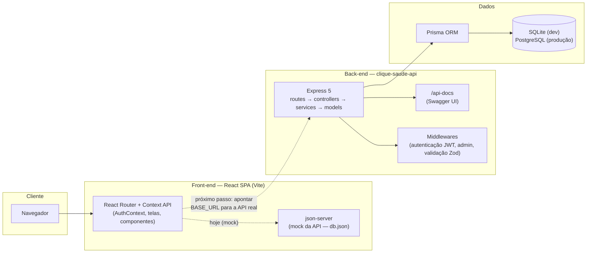
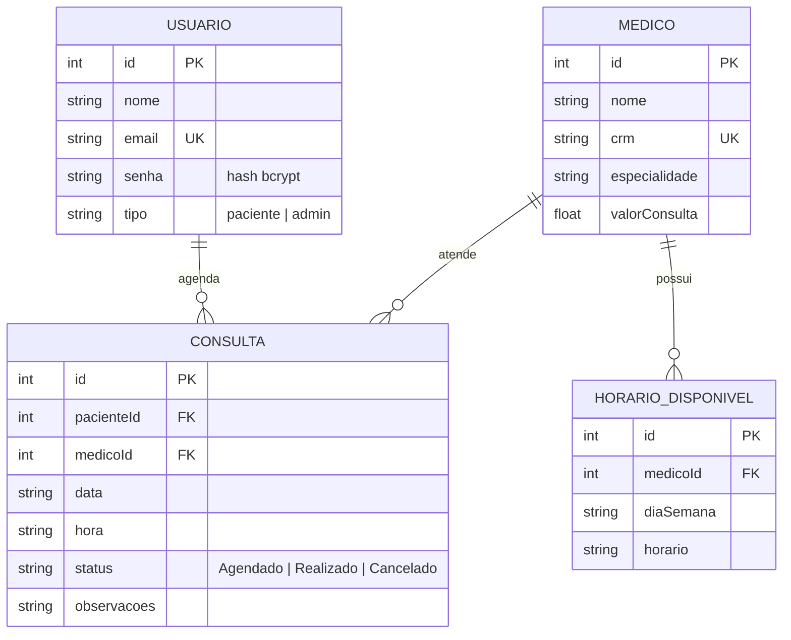
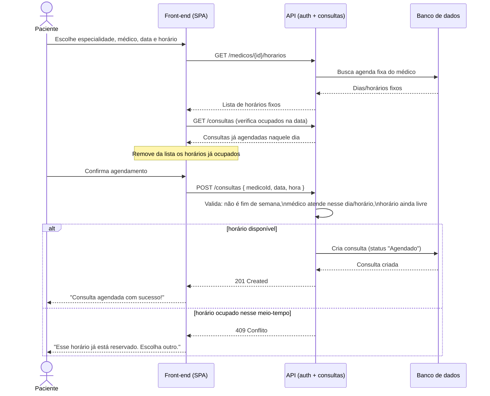

# Arquitetura e Modelo de Dados — Clique Saúde

## 1. Visão geral (diagrama de arquitetura)

**Por que duas "APIs" no diagrama?** O front-end (Atividades 1 e 3) foi
construído e testado contra um mock (`json-server`) que replica fielmente o
schema do back-end real. O back-end real (Atividades 2, 3 e 4) já está
pronto, testado (57 testes, ~96% de cobertura) e documentado via Swagger —
o único passo restante para integração total é trocar o `BASE_URL` do
serviço de API do front-end (`src/services/clinicaApi.js`) para apontar
para `clique-saude-api` em vez do mock. Essa decisão está documentada desde
o relatório da Atividade 1 (fase final do roadmap).

## 2. Modelo de dados (diagrama entidade-relacionamento)

Este é o schema real do Prisma
([`prisma/schema.prisma`](https://github.com/Weslley0129/atividade-pratica-de-extenss-o-2/blob/main/prisma/schema.prisma))
— o mesmo desde a Atividade 2, sem alterações estruturais.

## 3. Fluxo de agendamento de consulta

