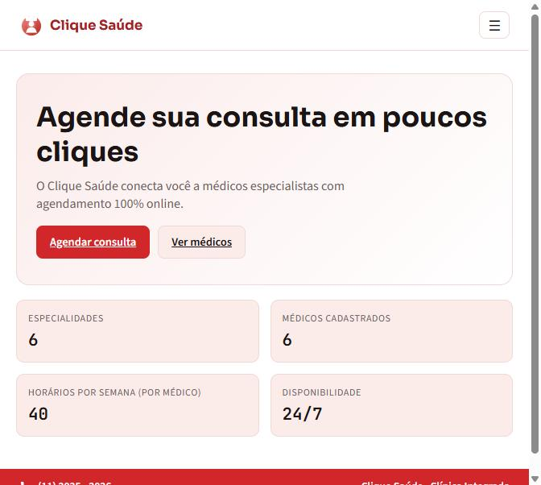
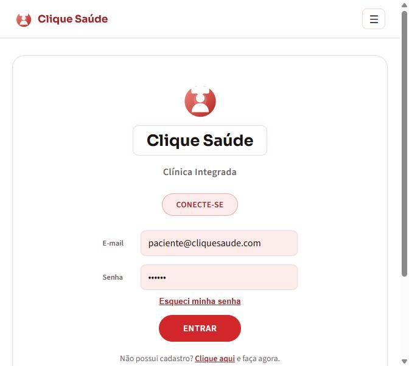
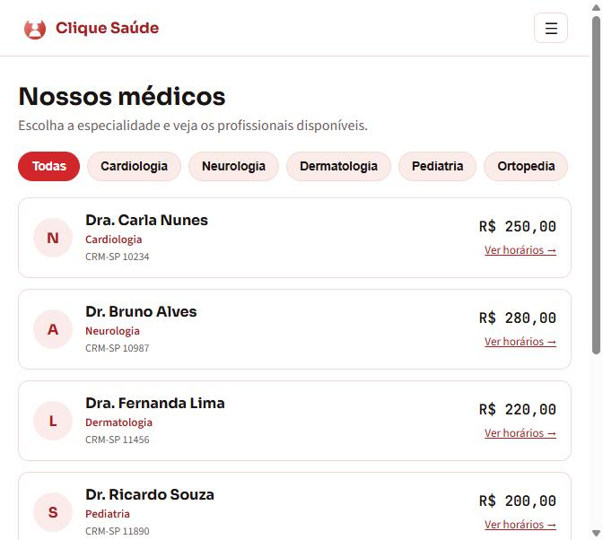
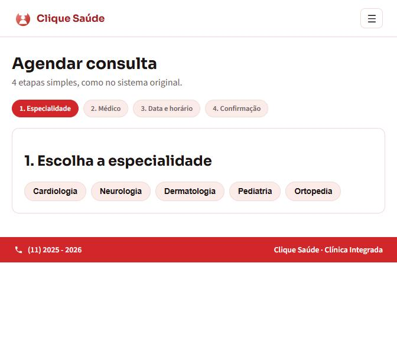
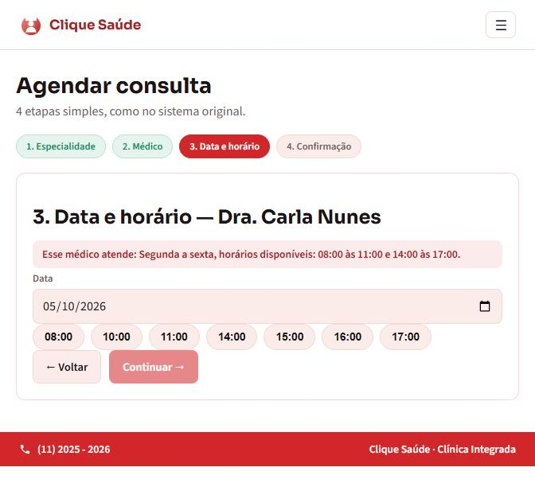
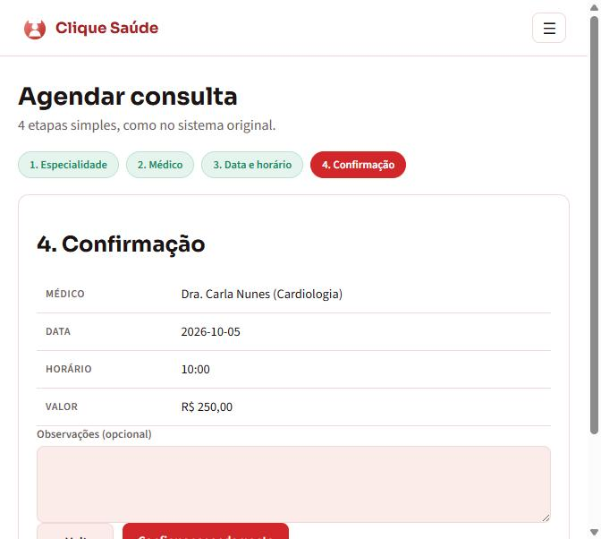
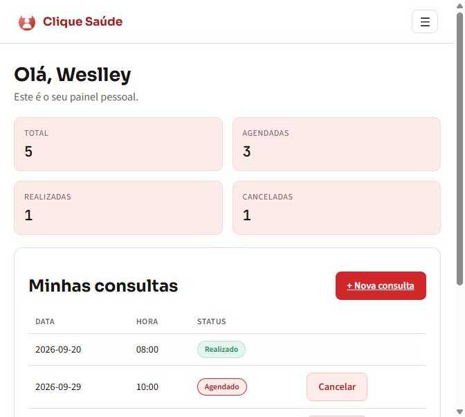
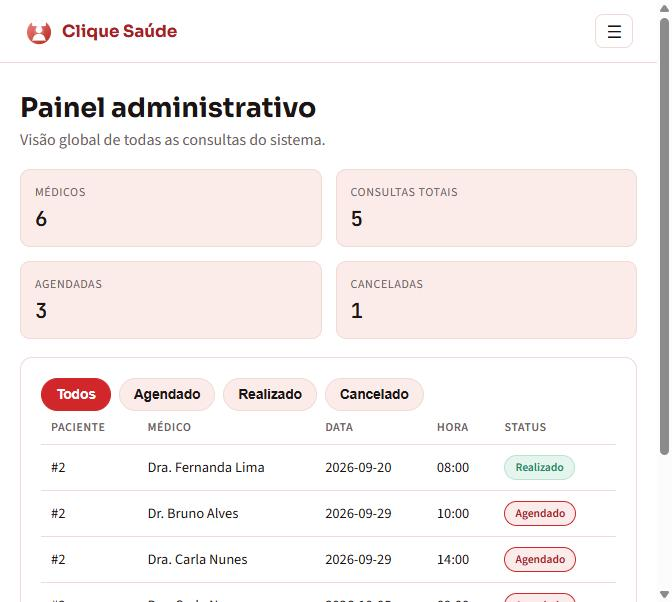

# Manual do Usuário — Clique Saúde

Este manual explica como usar o Clique Saúde do ponto de vista de quem usa o
sistema no dia a dia — paciente ou administrador da clínica — sem precisar
entender nada de código. Qualquer pessoa deve conseguir seguir este guia e
operar o sistema sozinha.

## Índice

1. [Página inicial](#1-página-inicial)
2. [Criar conta e entrar](#2-criar-conta-e-entrar)
3. [Ver médicos disponíveis](#3-ver-médicos-disponíveis)
4. [Agendar uma consulta](#4-agendar-uma-consulta)
5. [Meu painel (acompanhar e cancelar consultas)](#5-meu-painel)
6. [Painel administrativo](#6-painel-administrativo-somente-admin)

---

## 1. Página inicial

Ao abrir o sistema, a página inicial mostra um resumo (número de
especialidades, médicos cadastrados, horários disponíveis por médico) e dois
atalhos: **Agendar consulta** e **Ver médicos**.

---

## 2. Criar conta e entrar

Clique em **Entrar** no menu (ou tente agendar uma consulta sem estar
logado — o sistema pede login automaticamente). Se ainda não tem conta,
clique em **"Clique aqui"** na tela de login para se cadastrar como
paciente.

**Contas de teste já cadastradas:**

| Perfil | E-mail | Senha |
|---|---|---|
| Paciente | `paciente@cliquesaude.com` | `123456` |
| Administrador | `admin@cliquesaude.com` | `admin123` |

---

## 3. Ver médicos disponíveis

No menu, clique em **Médicos**. A lista pode ser filtrada por especialidade
(Cardiologia, Neurologia, Dermatologia, Pediatria, Ortopedia). Cada médico
mostra o valor da consulta e um link **"Ver horários →"** com a agenda fixa
semanal dele.

---

## 4. Agendar uma consulta

O agendamento é um assistente (wizard) de 4 etapas:

**Etapa 1 — Especialidade.** Escolha a especialidade desejada.

**Etapa 2 — Médico.** Escolha um médico entre os disponíveis na
especialidade selecionada.

**Etapa 3 — Data e horário.** Escolha uma data. O sistema mostra, logo
acima do campo de data, **em quais dias e horários aquele médico atende**
(por exemplo: *"Segunda a sexta, horários disponíveis: 08:00 às 11:00 e
14:00 às 17:00"*). Depois de escolher a data, os horários livres aparecem
como botões — horários já ocupados por outro paciente não aparecem na
lista.

> **Dica:** se a mensagem "Nenhum horário livre nesse dia" aparecer, é
> porque o médico não atende naquele dia da semana — escolha uma das datas
> indicadas na dica acima do calendário. Consultórios não atendem aos
> finais de semana.

**Etapa 4 — Confirmação.** Revise médico, data, horário e valor da
consulta, adicione uma observação se quiser, e clique em **"Confirmar
agendamento"**.

---

## 5. Meu painel

Acesse **"Meu Painel"** no menu para ver o resumo das suas consultas
(total, agendadas, realizadas, canceladas) e a lista completa. Uma consulta
com status **"Agendado"** pode ser cancelada a qualquer momento pelo botão
**"Cancelar"** ao lado dela.

---

## 6. Painel administrativo (somente admin)

Ao entrar com uma conta do tipo **admin**, o menu ganha a opção **"Painel
administrativo"**: uma visão global de todas as consultas de todos os
pacientes, com filtro por status (Agendado / Realizado / Cancelado).

> Cadastro, edição e remoção de médicos ainda são feitos apenas pela API
> (`POST` / `PUT` / `DELETE /medicos`, documentados no Swagger — veja a
> [documentação da API](../README.md#índice-da-documentação)); a tela de
> administração de médicos pela interface é um próximo passo natural de
> evolução do projeto.
